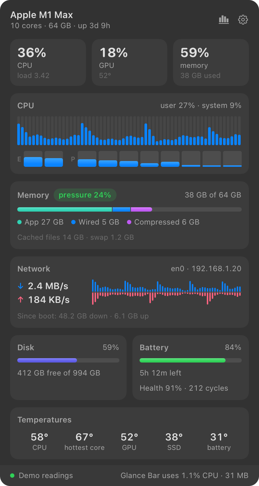
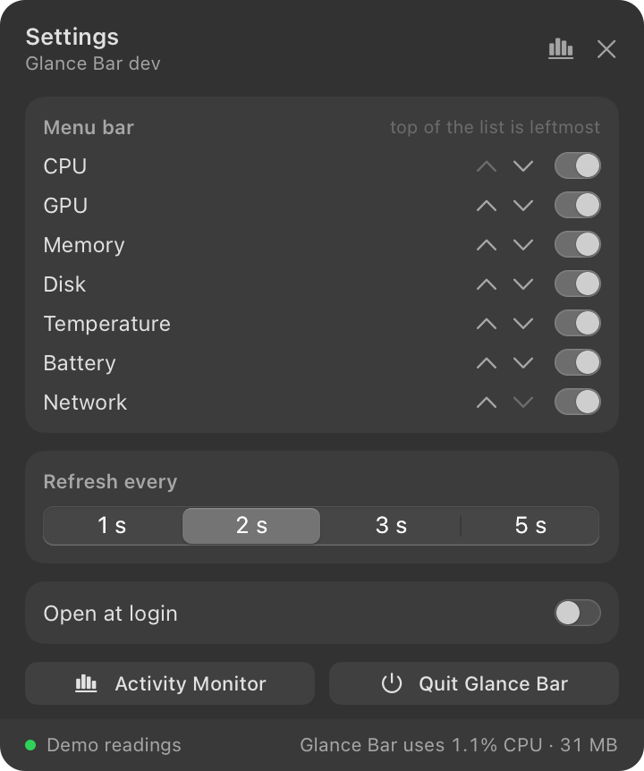

# Glance Bar

Glance Bar is a macOS menu bar app that shows CPU, GPU, memory, disk, temperature, battery and
network activity in one compact item, with a detail panel behind a click.

<p align="center">
  
</p>

<p align="center">
  
  
</p>

The screenshots show the made-up readings of [demo mode](#try-it-without-installing).

## Quickstart

You need macOS 15 or later on Apple silicon and a Swift 6 toolchain (Xcode or the Command Line
Tools).

```bash
git clone https://github.com/RobinVivant/glance-bar.git
cd glance-bar
scripts/install.sh
```

The script builds `Glance Bar.app`, copies it to `~/Applications` and opens it. The item appears
in the menu bar; click it for the panel. The first launch from an Applications folder turns on
Open at Login. Run the script again to update.

If the item does not show up, the menu bar is full: macOS puts new items behind the `«` chevron
at the left end of the status area. Hold Command and drag the item to where you want it.

### Try it without installing

Demo mode runs the app on made-up readings. It reads no sensor and saves no setting.

```bash
swift run GlanceBar --demo
```

## What it shows

- **Menu bar**: seven meters, each of which you can hide or reorder.

    | Meter | Drawn as | Reading |
    |-------|----------|---------|
    | CPU | History graph, 12 bars | Total load at each refresh |
    | GPU | Gauge | Utilization of the busiest GPU |
    | Memory | Gauge | Memory pressure, the figure Activity Monitor graphs |
    | Disk | Gauge | Used share of the startup volume |
    | Temperature | Text | Average of the CPU core sensors, in °C |
    | Battery | Text | Charge percent; left out on a Mac without a battery |
    | Network | Two lines of text | Upload over download, summed over the `en*` interfaces |

- **Colors**: the item is monochrome and follows the menu bar's appearance. A reading turns
  orange, then red, at fixed thresholds.

    | Reading | Orange | Red |
    |---------|--------|-----|
    | CPU and GPU load | 85% | 95% |
    | Memory | Kernel pressure level "warning" | Kernel pressure level "critical" |
    | Disk used | 90% | 95% |
    | Temperature | 90° | 100° |
    | Battery, on battery power only | 20% | 10% |
    | Battery health, in the panel | Below 80% | Never |

- **Panel** (left click): CPU history and one bar per core, memory split into app, wired and
  compressed with the pressure level, network rates with a chart and the totals since boot, disk
  space, battery time, health and cycle count, and the CPU, GPU, SSD and battery temperatures.
  Battery health is what a full charge holds as a share of the design capacity, the figure macOS
  calls Maximum Capacity. The footer shows what Glance Bar itself uses.
- **Settings** (the gear in the panel): a switch and order arrows per meter, the refresh interval
  (1, 2, 3 or 5 seconds, 2 by default), Open at Login, Activity Monitor and Quit.
- **Right click**: Open Activity Monitor and Quit.

## What it costs

Measured on a MacBook Pro M1 Max with three displays, every meter on and a 2 second refresh,
with `ps -o cputime` and `footprint`:

| | CPU | Memory |
|---|-----|--------|
| In the background, the normal case | 1.2% of one core | 18 MB |
| After the panel was opened once | Same | About 33 MB |

In the same minutes, the menu bar process of iStat Menus 7 used 2.2% and 116 MB with a
comparable set of meters.

Most of the cost is not sampling. A profile shows about a tenth of the time in the samplers and
the rest in AppKit, which redraws the item for each display every time its pixels change. Fewer
displays or a longer refresh interval lower it in proportion. macOS runs a background app on
the efficiency cores, where the same work counts as about twice the CPU time: the figure was
0.6% while Glance Bar was the front app.

What keeps it low:

- One timer drives everything, with 10% leeway so macOS can group the wake-up with others. It
  stops while the displays sleep.
- A hidden meter is not sampled while the panel is closed.
- The item redraws only when a pixel would change. Readings are first reduced to what gets
  drawn (bar heights in half points, rounded text), and equal results skip the redraw.
- Each rendering is drawn once per appearance and display scale, then copied.
- Battery changes arrive as system events. Disk space is read once a minute.
- The panel is built when it opens and dropped when it closes.
- There is no helper process, no dependency and no network access.

## What it reads

| Reading | Source |
|---------|--------|
| CPU load | `host_statistics`, and `host_processor_info` per core while the panel is open |
| GPU | `PerformanceStatistics` of the `IOAccelerator` services |
| Memory | `host_statistics64`, `kern.memorystatus_level` and `kern.memorystatus_vm_pressure_level` |
| Temperatures | The System Management Controller, read-only, through the `AppleSMC` service |
| Network | Interface byte counters from `sysctl` (`NET_RT_IFLIST2`) |
| Battery | IOKit power sources, and `AppleSmartBattery` for the capacities and the cycle count |
| Disk | Volume capacity of `/`, counting the space macOS can free on demand |

Settings live in the app's user defaults (`local.glance-bar`). The app writes no other file and
opens no network connection.

The temperature sensor keys differ per chip generation. The M1 list is checked on real
hardware, where its average matches the CPU temperature iStat Menus shows. The lists for M2 to
M5 follow the [Stats](https://github.com/exelban/stats) project and are not checked here. On an
unknown chip the app tries every known key and keeps the ones the Mac has.

## Uninstall

Turn off Open at login in the settings, choose Quit, then:

```bash
rm -rf "$HOME/Applications/Glance Bar.app"
defaults delete local.glance-bar
```

## Development

```bash
swift test                                            # the GlanceCore test suite
swift run GlanceBar --demo                            # the app on made-up readings
swift run GlanceBar --snapshot /tmp/glance-bar --demo # the item and the panel as PNG files, dark and light
scripts/build-app.sh                                  # the release app bundle in build/
```

- `Sources/GlanceCore`: samplers, the math behind each reading, formatting, settings and the
  render model of the menu bar item. No AppKit. Covered by `Tests/GlanceCoreTests`.
- `Sources/GlanceBar`: the status item and its Core Graphics renderer, the sampling loop, the
  popover and its SwiftUI views.
- `scripts/`: build, install, release packaging and the icon generator.

Without `--demo`, `--snapshot` renders the live readings of your Mac. The images in
`docs/screenshots` come from `--snapshot docs/screenshots --demo`.

CI builds, tests and renders the demo snapshots on every pull request. Pushing a tag such as
`v1.0.0` that matches the version in `Resources/Info.plist` publishes `Glance Bar.app` as a
zipped GitHub release. The build is signed ad hoc and not notarized by Apple, so macOS blocks
the first launch of a copy downloaded with a browser until you clear its quarantine mark:

```bash
xattr -dr com.apple.quarantine "Glance Bar.app"
```
